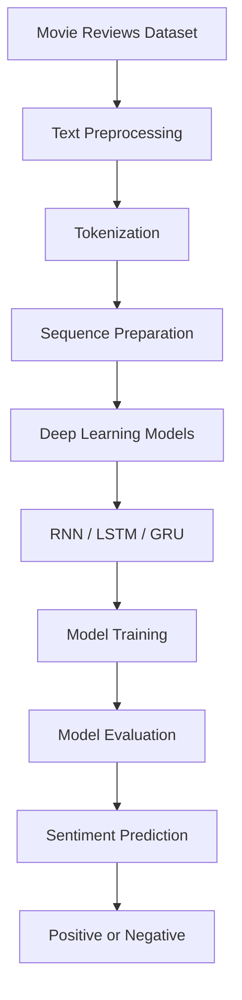

# 🎬 Movie Review Sentiment Analysis

### Deep Learning | NLP | Python | TensorFlow

An NLP-based sentiment analysis project that uses Deep Learning architectures to classify movie reviews as **Positive** or **Negative**. Built using Python and TensorFlow, the project explores RNN, LSTM, and GRU models for understanding sentiment in textual data.

---

## 📌 Table of Contents

- [Overview](#-overview)
- [Key Features](#-key-features)
- [Tech Stack](#-tech-stack)
- [Project Workflow](#-project-workflow)
- [Deep Learning Models](#-deep-learning-models)
- [Results](#-results)
- [Installation](#-installation)
- [Future Improvements](#-future-improvements)

---

## 🔍 Overview

Understanding customer opinions and feedback is important for businesses and entertainment platforms.

This project applies Natural Language Processing (NLP) and Deep Learning techniques to analyze movie reviews and identify their underlying sentiment.

The model processes textual reviews and predicts whether the expressed opinion is positive or negative.

**Objective:** Build and explore deep learning models capable of learning contextual patterns from text for binary sentiment classification.

## ✨ Key Features

- 🎯 Binary sentiment classification (Positive / Negative).
- 🧠 Deep Learning-based text classification.
- 🔄 Exploration of RNN, LSTM, and GRU architectures.
- 📝 Text-based sentiment prediction.
- 📊 Model performance evaluation.
- ⚡ Approximately 90% accuracy achieved.

## 🛠️ Tech Stack

| Category | Technologies |
|---|---|
| Programming | Python |
| Deep Learning | TensorFlow |
| NLP | Text preprocessing and tokenization |
| Model Architectures | RNN, LSTM, GRU |
| Development | Jupyter Notebook |

## 🔄 Project Workflow



## 🧠 Deep Learning Models

The project explores three recurrent neural network architectures:

<details>
<summary><strong>1. Recurrent Neural Network (RNN)</strong></summary>

RNNs process sequential data by maintaining information from previous time steps. They provide a foundation for understanding sequential patterns in text.

</details>

<details>
<summary><strong>2. Long Short-Term Memory (LSTM)</strong></summary>

LSTM networks use memory cells and gating mechanisms to learn long-term dependencies in sequential data, helping address the vanishing gradient problem associated with traditional RNNs.

</details>

<details>
<summary><strong>3. Gated Recurrent Unit (GRU)</strong></summary>

GRU is a recurrent architecture that uses update and reset gates to capture sequential dependencies with a simpler structure than LSTM.

</details>

## 📊 Results

<details open>
<summary><strong>Model Performance</strong></summary>

| Evaluation | Result |
|---|---|
| Task | Binary Sentiment Classification |
| Classes | Positive / Negative |
| Accuracy | Approximately 90% |

</details>

The project demonstrates how recurrent neural network architectures can be applied to understand sentiment in textual movie reviews.

## ⚙️ Installation

### 1. Clone the repository

```bash
git clone YOUR_GITHUB_REPOSITORY_URL
cd YOUR_PROJECT_FOLDER
```

### 2. Create a virtual environment

```bash
python -m venv venv
```

Activate it:

**Windows**
```bash
venv\Scripts\activate
```

**Linux / macOS**
```bash
source venv/bin/activate
```

### 3. Install dependencies

```bash
pip install tensorflow numpy pandas scikit-learn matplotlib
```

### 4. Run the project

Open the project notebook in Jupyter Notebook and execute the cells.

> Note: Update the installation commands and execution instructions according to your actual project files and dependencies.

## 🚀 Future Improvements

- Develop an interactive web interface for real-time sentiment prediction.
- Experiment with Transformer-based NLP architectures.
- Compare model performance using precision, recall, and F1-score.
- Deploy the trained model through a REST API.

---

## 👨‍💻 Author

**Govind Prasad**

- GitHub: [Govindprasad1](https://github.com/Govindprasad1)
- LinkedIn: [Govind Prasad](https://www.linkedin.com/in/govind-prasad-1a510b227)

---

⭐ If you find this project interesting, consider giving the repository a star!
